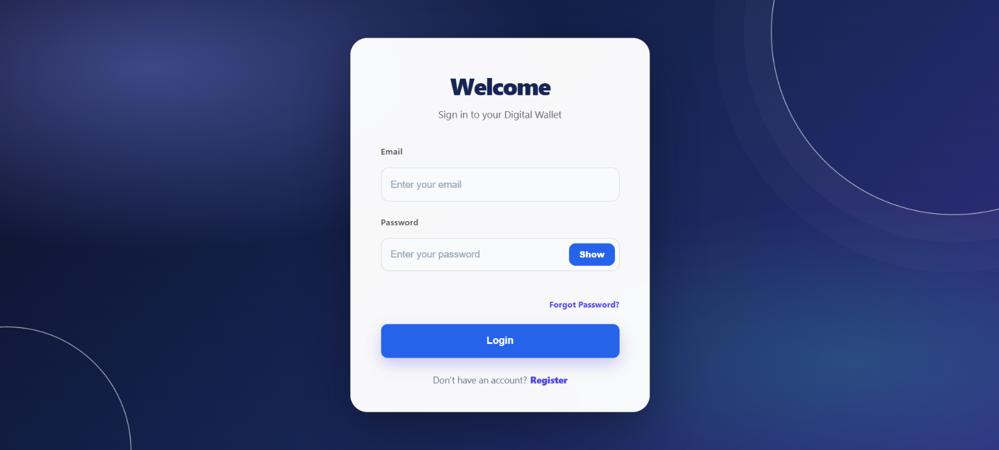
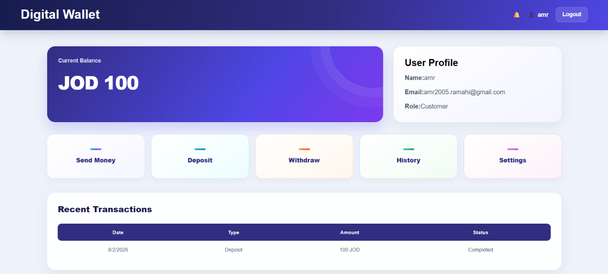
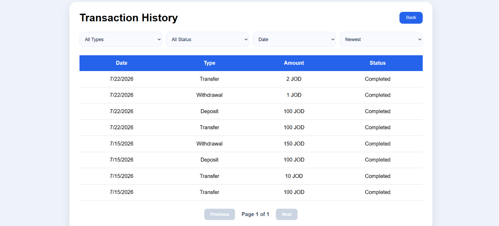
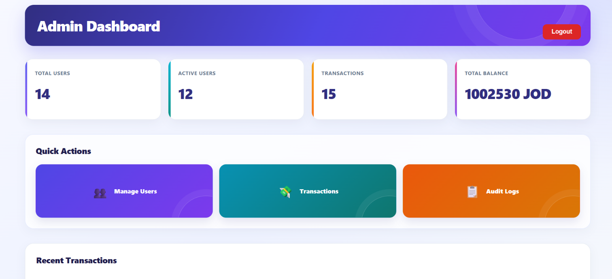
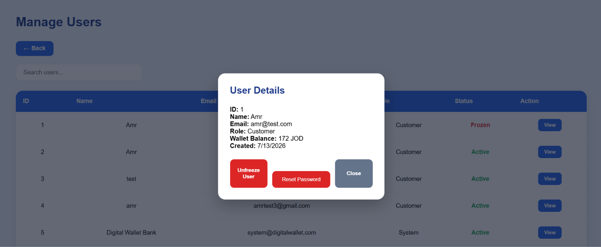
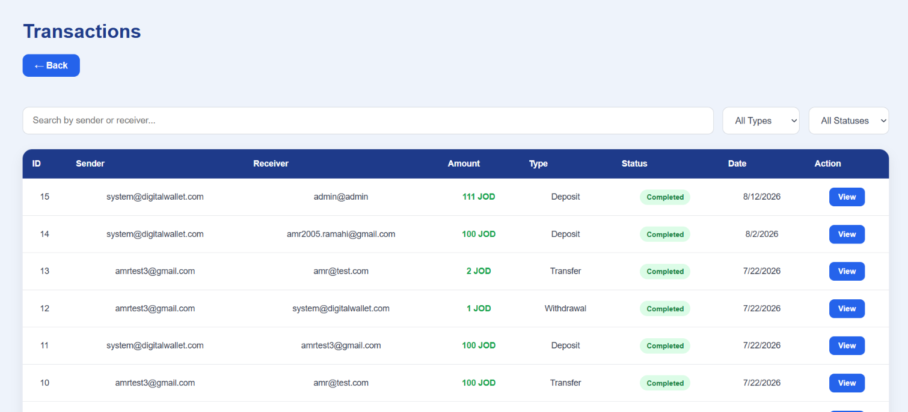
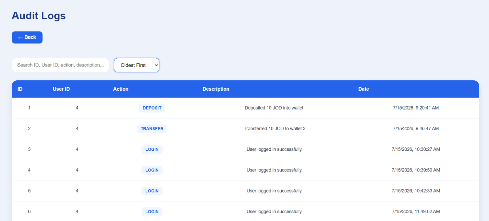

# 💳 Digital Wallet System

A full-stack digital wallet application built with **ASP.NET Core Web API** and **React**, designed to simulate core digital banking and wallet operations.

The system allows users to securely manage their wallets, perform financial transactions, and manage their accounts, while administrators can monitor users, transactions, and system activity.

<p align="center">
  <a href="https://digitalwallet-amr-frontend.pages.dev/">
    
  </a>
  <a href="https://github.com/amrra05/DigitalWalletSystem">
    
  </a>
</p>

---

## 📸 Screenshots

Here are some screenshots showcasing the user interface and main functionalities of the Digital Wallet System.

### 🔐 Login Page



### 👤 User Dashboard



### 💳 User Transaction History



### 📊 Admin Dashboard



### 👥 Admin User Management



### 📋 Admin Transaction Management



### 📝 Admin Audit Logs



---

## ✨ Features

### User Features

- User registration and login
- JWT-based authentication
- Refresh token authentication
- Email verification
- Forgot password and password reset
- Change password
- User profile management
- Wallet balance management
- Deposit funds
- Withdraw funds
- Transfer money between users
- Transaction history
- Transaction status tracking
- Protected user routes
- Responsive dashboard

### Admin Features

- Admin dashboard
- View and manage users
- Search and paginate users
- View user details
- Freeze and unfreeze users
- Reset user passwords
- View and monitor transactions
- Search transactions
- Paginate transactions
- View audit logs
- Search audit logs
- Sort audit logs by date
- Monitor system activity

---

## 🛠️ Technologies

### Backend

- C#
- ASP.NET Core Web API
- Entity Framework Core
- SQL Server
- JWT Authentication
- BCrypt
- FluentValidation
- REST APIs
- Clean Architecture
- Repository Pattern
- Unit of Work Pattern

### Frontend

- React
- JavaScript
- HTML5
- CSS3
- Axios
- React Router
- Context API
- Vite

### Development Tools

- Visual Studio
- Visual Studio Code
- SQL Server
- Git
- GitHub
- Swagger / OpenAPI

---

## 🏗️ Architecture

The backend follows a **Clean Architecture** structure that separates business logic, application logic, infrastructure, and API concerns.

```text
DigitalWalletSystem
│
├── DigitalWallet.API
│   ├── Controllers
│   ├── Middleware
│   └── Program.cs
│
├── DigitalWallet.Application
│   ├── DTOs
│   ├── Interfaces
│   ├── Services
│   ├── Validators
│   ├── Settings
│   └── Exceptions
│
├── DigitalWallet.Domain
│   ├── Entities
│   └── Enums
│
├── DigitalWallet.Infrastructure
│   ├── Data
│   ├── Repositories
│   └── Migrations
│
└── DigitalWallet.Client
    └── React Frontend
```

### Request Flow

```text
React Frontend
      │
      │ HTTP Request
      ▼
ASP.NET Core API
      │
      ▼
Application Services
      │
      ▼
Repositories
      │
      ▼
Entity Framework Core
      │
      ▼
SQL Server
```

This separation keeps the business logic independent from the database and presentation layers and makes the application easier to maintain and extend.

---

## 🗄️ Database

The application uses **SQL Server** with Entity Framework Core Code First.

Main entities include:

- User
- Wallet
- Transaction
- AuditLog
- RefreshToken
- EmailVerificationToken
- PasswordResetToken

The project also contains EF Core migrations for managing database schema changes.

---

## 🔐 Authentication and Security

The system implements several security mechanisms:

- JWT authentication
- Refresh tokens
- BCrypt password hashing
- Role-based authorization
- Protected API endpoints
- Protected React routes
- Email verification
- Password reset tokens
- User account freezing
- Exception handling middleware
- Audit logging
- Transaction idempotency
- Wallet concurrency handling

Financial operations are handled through backend services and database transactions to help maintain consistent wallet balances.

---

## 💰 Transaction Management

The wallet system supports:

- Deposits
- Withdrawals
- User-to-user transfers
- Transaction history
- Transaction status tracking
- Idempotency protection
- Wallet balance validation
- Concurrency handling

Transfer operations use a transaction-based workflow so that the sender and receiver wallet updates are handled as one logical operation.

---

## 📊 Admin Dashboard

Administrators can monitor the system through a dedicated dashboard.

The admin interface includes:

- User management
- Transaction monitoring
- Audit log monitoring
- User search
- Transaction search
- Audit log search
- Pagination
- Date-based sorting
- User freeze/unfreeze
- Password reset

---

## 💻 Frontend

The React frontend is separated from the ASP.NET Core backend and communicates with the API through HTTP requests.

The application contains pages for:

- Login
- Registration
- Email verification
- Forgot password
- Password reset
- User dashboard
- Deposit
- Withdraw
- Send money
- Transaction history
- Settings
- Admin dashboard
- Admin users
- Admin transactions
- Admin audit logs

The frontend also uses protected and role-based routes to prevent unauthorized access to application pages.

---

## 🚀 Running the Project

### Backend

Open the solution:

```text
DigitalWalletSystem.slnx
```

Configure the required local settings using ASP.NET Core User Secrets rather than committing sensitive credentials to the repository.

The application requires a SQL Server database.

Apply the existing Entity Framework Core migrations and then run:

`DigitalWallet.API`

Swagger can be used to test the API endpoints during development.

### Frontend

Navigate to the React project:

```bash
cd DigitalWallet.Client
```

Install the dependencies:

```bash
npm install
```

Start the development server:

```bash
npm run dev
```

The frontend will then run using the Vite development server.

---

## 📁 Project Structure

| Project | Responsibility |
|---|---|
| `DigitalWallet.API` | API controllers, middleware, and application entry point |
| `DigitalWallet.Application` | Business logic, DTOs, services, interfaces, and validation |
| `DigitalWallet.Domain` | Core entities and enums |
| `DigitalWallet.Infrastructure` | Database, EF Core, repositories, and migrations |
| `DigitalWallet.Client` | React frontend |

---

## 🔮 Future Improvements

Possible future improvements include:

- Automated unit and integration testing
- Production database configuration
- Docker containerization
- CI/CD pipeline
- Deployment to a cloud platform
- Improved monitoring and logging
- Additional transaction reporting
- More advanced admin permissions

---

## 👨‍💻 Author

**Amr Alramahi**

Computer Science Student  
Jordan University of Science and Technology

This project was developed as a full-stack software engineering project to practice backend architecture, API development, database design, authentication, financial transaction handling, React frontend development, and production-oriented software practices.

---

<p align="center">
  <b>Digital Wallet System</b><br>
  Built with ASP.NET Core Web API, React, and SQL Server.
  <br><br>
  <a href="https://digitalwallet-amr-frontend.pages.dev/">
    View Live Project
  </a>
</p>
